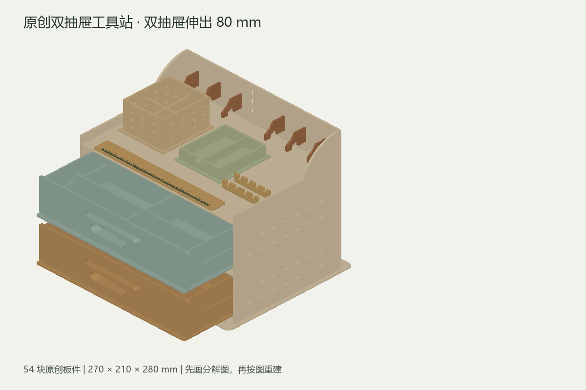

# LaserMaker Plugin

[简体中文](README.zh-CN.md)

Precise laser-cutting and engraving design for **Codex, Claude Code, Kimi Code, and DeepSeek Harness**, with a shared MCP server and Windows LaserMaker automation.

## Install with one command

On **Windows x64**, with **Node.js 20+**, **Git**, and your agent CLI installed:

```powershell
npx --yes --allow-git=root github:MosesMuxiXie/lasermaker-plugin install codex
```

Replace `codex` with `claude`, `deepseek`, or `kimi`. Codex and Claude use their native plugin installers; DeepSeek uses the `laser` profile. Kimi prints one command to paste into its conversation, followed by `/reload`.

`--allow-git=root` explicitly permits this GitHub package for the current command, as required by npm 12. It does not change your global npm configuration.

The installer downloads the verified portable runtime, checks its SHA-256, installs it in your user profile, and connects the selected host. **No npm account, system Python, administrator access, manual extraction, or executable-path editing is required.** The first download is about 140 MB; later runs use the verified cache.

This is a **GitHub-backed npm package**, not a package published to the npm registry. The installer/integration package is **0.1.3**; its unchanged, tested Windows runtime is **0.1.2**. The runtime's `doctor` command reports `0.1.2`.

```powershell
# Check the installation
npx --yes --allow-git=root github:MosesMuxiXie/lasermaker-plugin doctor

# Print a ready-to-paste config for another stdio MCP host
npx --yes --allow-git=root github:MosesMuxiXie/lasermaker-plugin config
```

Prefer a permanent command?

```powershell
npm install -g --allow-git=root github:MosesMuxiXie/lasermaker-plugin
lasermaker-plugin install codex
```

See the [installation guide](docs/installation.md) for custom directories, other profiles, updating, and troubleshooting.

### Without Node.js

Download **`lasermaker-agent-0.1.3-plugin.zip`** from [Releases](https://github.com/MosesMuxiXie/lasermaker-plugin/releases/latest), verify it with `SHA256SUMS.txt`, and extract it. The ZIP includes Python. Register the extracted plugin root using the short [offline installation steps](docs/installation.md#without-nodejs-offline-zip).

GitHub's automatic source archive contains source code, not the portable runtime. The small installer `.tgz` downloads the runtime on demand.

## What it does

- **17 MCP tools and the same CLI operations:** project creation, precise edits, preflight, Windows import, layer settings, native save/reopen verification, checkpoints, and delivery export.
- Millimetre coordinates, stable object IDs, curves, nodes, outlined text, holes/slots, transforms, arrays, alignment, Boolean operations, and offsets.
- SVG/DXF output, staged engraving/inner-cut/outer-cut files, and recoverable project state shared across agents.
- Preserves user edits and stops on unknown dialogs or uncertain GUI outcomes. It does not blindly retry an import.

**There is no tool to send or start a laser job.** Material fit and machine settings require on-site testing.

GUI tools require an unlocked Windows desktop and **LaserMaker 2.1.7.2**, at `C:/Program Files/LaserMaker2/Bin/LaserMaker.exe`. Geometry tools can be used before LaserMaker is installed. Handle recovery dialogs and save your own work before automation.

## Try a complete product



The [original workstation](examples/original-workstation/README.md) starts with frozen dimensioned plans, then independently reconstructs **54 parts, 987 drawing objects, 4 sheets, 120 tab/slot joints, and 80 mm drawer travel**. It includes editable source, SVG/DXF, native `.lcpx`, a separate fit coupon, assembly instructions, STL/OpenSCAD, and an offline interactive 3D viewer. Detailed design documents are currently in Chinese.

Other examples: [39-part flat-pack tank](examples/sherman-tank/装配说明.md), [synthetic slot coupon](examples/slot-coupon/), and [engraving modes](examples/engraving-modes/说明.md).

A useful request for your agent:

> Design a detailed flat-pack organizer for nominal 3 mm stock. First draw dimensioned disassembly plans, then reconstruct the cutting paths, slots, text outlines, and assembly relationships. Preflight the geometry, import it into LaserMaker, verify dimensions and layer settings, save it, close it, and reopen the exact native file. Deliver the editable source, SVG/DXF, native project, and fit coupon. Do not start the machine.

## Validation and limits

The pinned 0.1.2 core passed **91 Python checks, with 2 opt-in live tests skipped**. Five workstation native projects completed actual import, dimension checks, process setting, save, close, and exact-path reopen. The MCP object-limit test reached 20,000 objects and rejected object 20,001 without mutation.

Previously tested hosts: Codex CLI 0.164.0, Claude Code 2.1.310, Kimi Code 2.3.2, and DeepSeek Harness 0.2.1-rc.2 / Cordis 4.0.5. Native loading and tool discovery were checked for all four; Codex/DeepSeek native dispatch and Claude/Kimi host-resolved stdio calls were checked separately. Model-account conversations remain unverified.

The 120-minute continuous workload test is deferred. Physical fit, kerf, hardware, load/tipping, machine bed/controller, and actual toolpaths/processing remain unverified. `manufacturing_ready` stays `false`. Geometry tolerance (0.01 mm) and GUI readback tolerance (0.05 mm) are not machine-accuracy claims. Example speed/power values are readback tests, not production settings.

[Core validation report](docs/验证报告.md) · [API and recovery](docs/接口与恢复.md) · [LaserMaker tutorial](docs/使用教程.md) · [Installation](docs/installation.md)

## Development

```powershell
npm test
py -3.12 -m venv .venv
& .venv/Scripts/python.exe -m pip install -e '.[dev,design]'
& .venv/Scripts/python.exe -m pytest -q
```

The Node installer has no third-party dependencies or postinstall script. DeepSeek peer dependencies are supplied by that host and are optional for the downloader. Python development requires 3.12 x64; font tests use Windows Arial and Microsoft YaHei, which are not redistributed. `scripts/build.ps1` builds the Python runtime; the installer pins the separately verified core release.

## License

[MIT](LICENSE). Attribution to [Ganzhe2028/lasermaker-mcp-cli-skill](https://github.com/Ganzhe2028/lasermaker-mcp-cli-skill) and dependency notices are preserved in [THIRD_PARTY_NOTICES.md](THIRD_PARTY_NOTICES.md) and `licenses/`. Private original artwork and third-party reference-art datasets are excluded from public distribution.
